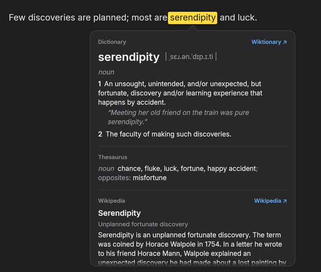

#  &nbsp; tlum

macOS's **Look Up**, for Linux. Force-click any word on screen to get its definition, synonyms
and Wikipedia summary in a popover. Works on KDE Plasma, GNOME, sway and other wlroots
compositors, Hyprland, niri, and X11.

<p>
  
  
</p>

## Triggers

| Device | Gesture |
| --- | --- |
| Touchpad | Press the pad down and hold still (~0.6 s), or tap with three fingers |
| Mouse | Hold the left button still (~0.6 s), or a side button via `mouse_button` |
| Keyboard | **Meta+Ctrl+D** over a word |

If a phrase is selected (*New York*), triggering on one of its words looks up the whole phrase.
In the popover, **Escape** or a click outside closes it, **Enter** opens the dictionary entry,
**Ctrl+C** copies the word, and **Settings…** at its end opens tlum's settings.

## Install

Needs Tesseract with English data, and membership in the `input` group (gestures read
`/dev/input`; input is only read, never blocked, and keyboards are never opened).

```sh
sudo dnf install tesseract tesseract-langpack-eng libxkbcommon-devel                 # Fedora
sudo apt install tesseract-ocr tesseract-ocr-eng libxkbcommon-dev libwayland-dev    # Debian/Ubuntu
sudo pacman -S tesseract tesseract-data-eng libxkbcommon wayland                    # Arch

sudo usermod -aG input $USER   # then log out and back in

cargo build --release
target/release/tlum install    # into ~/.local/bin, with autostart and the shortcut where possible
tlum doctor                    # check what works on this desktop
```

`tlum uninstall` undoes `install`.

### Shortcut setup

KDE, GNOME and X11 need nothing more. Elsewhere, start tlum and bind `tlum trigger`:

| Desktop | Config |
| --- | --- |
| sway | `exec tlum` · `bindsym Mod4+Ctrl+d exec tlum trigger` |
| Hyprland | `exec-once = tlum` · `bind = SUPER CTRL, D, exec, tlum trigger` |
| niri | `spawn-at-startup "tlum"` · `binds { Mod+Ctrl+D { spawn "tlum" "trigger"; } }` |
| Bare X11 WM | `tlum &` in `.xinitrc` |

## Usage

```
tlum                 run the daemon
tlum trigger         look up the word under the pointer
tlum define WORD     show the popover for WORD
tlum settings [PAGE] open the settings (or bring them forward), e.g. on `dictionaries`
tlum quit            stop the daemon
tlum lookup WORD     print what the popover would show for WORD
tlum dictionaries    list installed dictionaries (available · install ID · add PATH · remove ID)
tlum doctor          report the backend, capture, devices and OCR
tlum config          print the settings in effect
tlum style --init    copy the built-in CSS to edit
```

`TLUM_DEBUG=1 tlum` logs each step and saves the OCR input to `$XDG_RUNTIME_DIR/tlum/`.

## Settings

`tlum settings` (also **tlum Settings** in the app launcher after `tlum install`) has four pages.
Every change is saved at once, and a running tlum follows it; only a new backend or shortcut
restarts it.

- **General**: whether tlum is running (with Stop and Restart) and opens at login; which gestures look up (force click,
  three-finger tap, press and hold, and for how long; a mouse button); the keyboard shortcut;
  scrolling direction.
- **Dictionaries**: the popover's sources, ticked on or off and dragged into the order it shows
  them, as on macOS. Besides the online Dictionary, Thesaurus and Wikipedia you can download
  WordNet (an offline English dictionary and thesaurus) and FreeDict's bilingual dictionaries,
  or add any StarDict dictionary (`.ifo`, a folder or an archive, such as GoldenDict's).
  **Offline only** uses downloaded dictionaries alone, so nothing leaves the computer.
- **Appearance**: a theme (Default, Paper, Nord, Minimal), light or dark or the system's, accent
  and highlight colours, font, text size, width and height, how many definitions and lines of
  Wikipedia, and which parts show (the Settings… button too), with a live preview.
- **Advanced**: the screen backend, Tesseract's languages, the area read around the pointer,
  diagnostics (`tlum doctor`), and resetting.

Dictionaries live in `~/.local/share/tlum/dictionaries/`, one folder each.

## Configuration

The settings live in `~/.config/tlum/config.json`. Every field is optional:

```json
{
  "hold_ms": 600,
  "three_finger_tap": true,
  "force_click": false,
  "mouse_hold": true,
  "mouse_button": null,
  "backend": "auto",
  "shortcut": "Meta+Ctrl+D",
  "language": "en",
  "ocr_language": "eng",
  "offline": false,
  "dictionaries": [
    { "id": "dictionary", "enabled": true },
    { "id": "wordnet", "enabled": true },
    { "id": "wikipedia", "enabled": false }
  ],
  "appearance": { "theme": "paper", "scheme": "system", "accent": "#d0342c", "text_scale": 1.1 }
}
```

`mouse_button` takes `"side"`, `"extra"`, `"forward"`, `"back"` or `"middle"`. `backend` forces
`"kwin"`, `"x11"` or `"wayland"`. `ocr_language` accepts Tesseract combinations such as
`"eng+ukr"`. `dictionaries` lists sources in order: `dictionary`, `thesaurus`, `wikipedia` and
installed dictionaries by id (`tlum dictionaries`); unlisted ones follow, turned on.
`appearance` also takes `highlight`, `font`, `width`, `max_height`, `senses`, `wiki_lines`, and
`true`/`false` for `pronunciation`, `examples`, `pictures`, `marker`, `arrow` and `animations`
(left out, the theme decides).

The popover is styled with CSS: `~/.config/tlum/style.css` cascades over
[`assets/default.css`](assets/default.css), the theme and the appearance settings, and reloads
on save. Each part is a single class (`.popover`, `.marker`, `.headword`, `.sense`,
`.thesaurus`, …); `tlum style --default` lists them all. The themes are in
[`assets/themes`](assets/themes).

## How it works

tlum reads raw evdev gestures, finds the pointer and captures a strip of screen through
whichever backend the desktop allows (KWin scripts, X11, wlroots screencopy, Hyprland IPC or
the GNOME portal), OCRs it with Tesseract, and draws the highlighted word and popover in a
transparent [Rune](https://github.com/anomalyco/rune) overlay. Definitions come from the Free
Dictionary API, Wiktionary and Wikipedia (only the word leaves your machine), and from
downloaded WordNet and StarDict dictionaries, read on the machine.

## Limitations

- Away from KDE and Hyprland, held presses open the popover on release rather than during the press.
- GNOME relies on XWayland and the Screenshot portal: slower (~0.5 s) and asks permission once.
- libinput also turns a three-finger tap into a middle click, which can paste. Set
  `"three_finger_tap": true` if you want such behaviour.
- Tiny, low-contrast or stylised text may not be recognised.
- Lookups need the network, unless you download dictionaries and turn on *Offline only*.

## License

MIT
